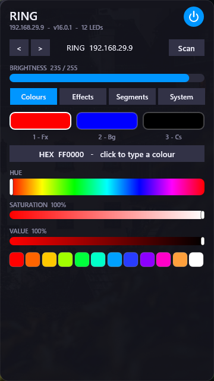
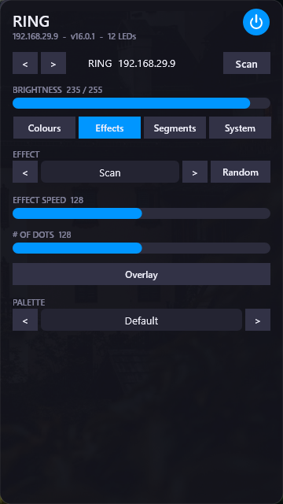
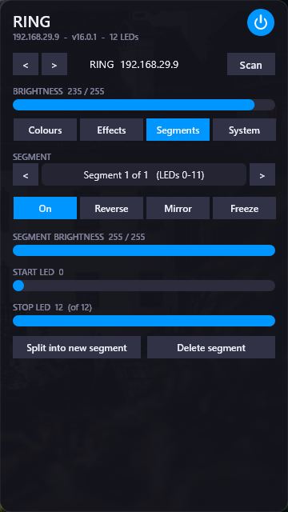
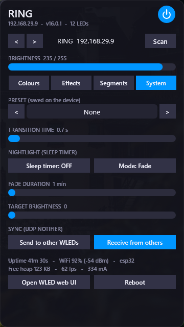

# WLED Control - Rainmeter skin

Controls WLED lights through WLED's JSON API (no plugin or DLL needed). Auto-discovers WLED devices on connected local IPv4 networks with up to 1,022 host addresses (Scan button). Manual device entry supports IPv4 addresses and DNS/mDNS hostnames such as `wled.local`; URLs, ports, IPv6 literals and paths are not accepted.

Tabs:
- Colours: primary/secondary/tertiary slots, hue/saturation/value, hex, swatches, white/CCT when supported.
- Effects: effect picker, per-effect sliders and options (speed, intensity, custom 1-3, toggles), colour slots and palette shown only when the effect uses them. Effect palette defaults from WLED's `/json/fxdata` metadata are reflected when selecting an effect; effects without a palette default keep the current palette.
- Segments: select, on/reverse/mirror/freeze, brightness, start/stop, split, delete.
- System: presets, transition, nightlight, UDP sync, device info, web UI, reboot.

Install: copy the `WLED Control` folder to `Documents\Rainmeter\Skins`, refresh Rainmeter, load `Main\WLED.ini`.

Command requests are sent one at a time and their HTTP result is reflected in the status line under the device name. If a command fails, the skin refreshes state from WLED instead of leaving the optimistic UI values in place. Network discovery reports scan errors separately from an empty result.

Troubleshooting: ensure the device is reachable over HTTP on the same connected local network. If auto-discovery cannot scan the network's subnet size, enter the device IP or hostname manually.

## Screenshots

| Colours | Effects |
| --- | --- |
|  |  |

| Segments | System |
| --- | --- |
|  |  |
